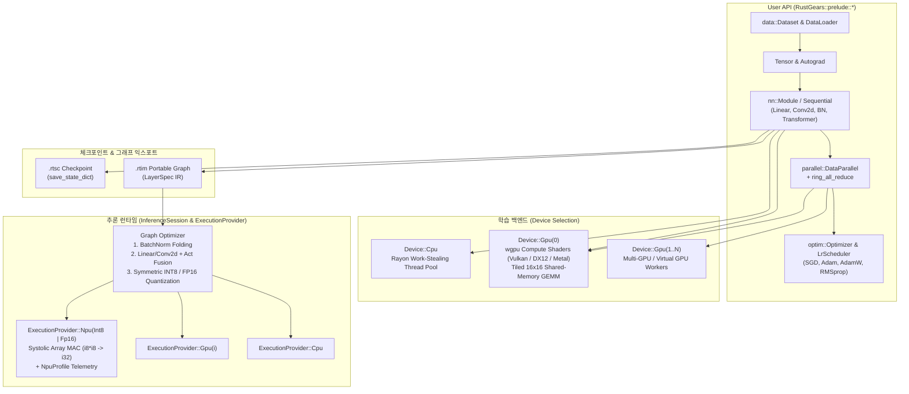

# RustGears — Rust 기반 PyTorch / TensorFlow 스타일 딥러닝 프레임워크

**RustGears**는 순수 Rust로 구현된 머신러닝 및 딥러닝 라이브러리입니다. PyTorch의 직관적인 동적 자동 미분(`Autograd`) 및 모듈(`nn::Module`) API와, TensorFlow / ONNX Runtime 스타일의 그래프 최적화 및 하드웨어 실행 프로바이더(`CPU` / `GPU` / `NPU`)를 결합했습니다.

---

## 핵심 기능 요약

| 영역 | 제공 기술 |
| :--- | :--- |
| **다차원 텐서 & 브로드캐스팅** | `Tensor` (`Arc` 기반 참조 카운팅), NumPy 스타일 브로드캐스팅, `matmul`/`bmm`, `conv2d`(`im2col`/`col2im`), `max_pool2d`, `permute`/`transpose`/`reshape`, 축 방향 축소(`sum_dim`, `mean_dim`, `var_dim`) |
| **역전파 자동 미분 (Autograd)** | 동적 계산 그래프(`Node`, `BackwardFn`), 위상 정렬(Topological Sort) 역전파, `requires_grad_(true)`, `backward()`, `no_grad(\|\| ...)` 가드 |
| **학습 장치 선택 (`Device`)** | `Device::Cpu` (`rayon` 멀티코어 Work-Stealing), `Device::Gpu(index)` (`wgpu` Vulkan / DirectX 12 / Metal WGSL Compute Shader + 가상 GPU 폴백), `Device::best_available()`, `tensor.to(dev)`, `model.to(dev)` |
| **멀티-GPU 데이터 병렬 학습** | `DataParallel` (미니배치 Scatter → 멀티 디바이스 동시 Forward/Backward → **Ring All-Reduce** 그래디언트 동기화 → Optimizer Step & 파라미터 Broadcast) |
| **신경망 레이어 (`nn`)** | `Linear`, `Conv2d`, `MaxPool2d`, `Flatten`, `BatchNorm1d`, `BatchNorm2d`, `LayerNorm`, **`RMSNorm`**, `Dropout`, `Embedding`, `MultiHeadAttention` (Causal Mask 지원), `TransformerEncoderLayer`, **`SwiGLU`**, `Sequential`, 활성화 함수(`Relu`, `Gelu`, `Sigmoid`, `Tanh`, `LeakyRelu`, **`Silu`**, `Softmax`), 초기화(`kaiming_uniform`, `xavier_uniform`) |
| **손실 함수 & 지표 (`nn::loss`, `nn::metrics`)** | `cross_entropy`, `cross_entropy_smooth` (Label Smoothing), `mse_loss`, `l1_loss`, `huber_loss`, `nll_loss`, `bce_with_logits`, `accuracy`, **`precision_recall_f1`**, **`top_k_accuracy`**, **`confusion_matrix`** |
| **옵티마이저 & 스케줄러 (`optim`)** | `Sgd` (Momentum / Nesterov), `Adam`, `AdamW` (Decoupled Weight Decay), `RmsProp`, `clip_grad_norm`, `StepLr`, `ExponentialLr`, `CosineAnnealingLr`, `WarmupCosineLr`, **`ReduceLROnPlateau`** |
| **학습 제어 & 콜백 (`optim`)** | **`EarlyStopping`** (Patience 감시 및 최적 가중치 자동 롤백), **`ModelCheckpoint`** (최고 성능 갱신 시 자동 저장), **`GradientAccumulator`** (대형 가상 배치 지원), **`ModelEMA`**, **`ProgressBar`** |
| **현대 모델 & 데이터 로딩** | **`KvCache`**, split-half **`RotaryEmbedding`** (RoPE), causal attention의 캐시 추론, **`DataLoader::iter_prefetch`** (bounded queue + 멀티스레드 샘플 로딩), **`AdaptiveAvgPool2d`**, **`ConvTranspose2d`** |
| **NPU 추론 엔진 (`inference`)** | `InferenceSession`, `ExecutionProvider::Npu(NpuPrecision::{Int8, Fp16})`, **BatchNorm 폴딩**, **연산자 퓨전(`Linear/Conv2d + BN + Activation`)**, **INT8 대칭 양자화(`i8 × i8 -> i32` Systolic MAC)**, 레이어별 MAC/GOPS/압축률 프로파일링(`NpuProfile`) |
| **직렬화 (`save`)** | 학습 체크포인트(`save_state_dict` / `load_state_dict`, `.rtsc` / **`.safetensors`**), Safetensors F32 저장·F32/F16/BF16 읽기, 배포용 포터블 추론 그래프(`save_inference_model` / `load_inference_layers`, `.rtim`) |

---

## 전체 시스템 아키텍처 (Mermaid)



---

## 빠른 시작 (Quick Start)

### 1. 예제 바로 실행하기

```bash
# 1) 전체 파이프라인: 장치 탐색 -> 4-Way GPU 데이터 병렬 학습 -> 모델 익스포트 -> NPU(INT8/FP16) 추론
cargo run --example end_to_end

# 2) 2D CNN 이미지 분류 학습 후 NPU 연산자 퓨전 & INT8 양자화 추론
cargo run --example cnn_npu

# 3) Multi-Head Self-Attention 기반 Transformer 시퀀스 정렬 학습
cargo run --example transformer

# 4) 통합 테스트 (수치 미분 검증, GPU 커널 검증, Ring All-Reduce, NPU 퓨전 등)
cargo test

# 5) Safetensors, KV-Cache/RoPE, 비동기 로더, 비전 레이어, EMA/진행 표시
cargo run --example modern_features --no-default-features
```

### 2. 기본 학습 + NPU 추론 코드

```rust
use RustGears::prelude::*;

fn main() -> Result<(), String> {
    manual_seed(42);

    // 1. 학습 장치 결정 (물리 GPU가 있으면 gpu:0, 없으면 cpu 자동 선택)
    let device = Device::best_available();
    println!("Using training device: {device} ({})", device.backend().name());

    // 2. 모델 정의 및 장치 이동
    let model = Sequential::new()
        .add(Linear::new(4, 32))
        .add(BatchNorm1d::new(32))
        .add(Relu)
        .add(Linear::new(32, 3));
    model.to(device);

    // 3. 데이터 및 옵티마이저 준비
    let x = Tensor::randn(&[64, 4]).on(device);
    let y = Tensor::from_vec((0..64).map(|i| (i % 3) as f32).collect(), &[64]).on(device);
    let mut opt = AdamW::new(model.parameters(), 1e-2, 1e-4);

    // 4. 학습 루프 (Forward -> Loss -> Backward -> Optimizer Step)
    model.train();
    for _epoch in 0..20 {
        opt.zero_grad();
        let logits = model.forward(&x);
        let loss = cross_entropy(&logits, &y);
        loss.backward();
        opt.step();
    }

    // 5. 학습된 모델을 NPU (INT8) 실행 프로바이더로 컴파일 및 추론 실행
    let npu_session = InferenceSession::from_module(&model, ExecutionProvider::npu_int8())?;
    println!("{}", npu_session.compilation_report());

    let preds = npu_session.run(&x);
    println!("Predictions shape: {:?}", preds.shape());
    println!("{}", npu_session.last_npu_profile().unwrap());
    Ok(())
}
```

---

## 상세 문서

- 추가된 다섯 기능의 API, 지원 범위와 분석·보완 결과는 **[docs/NEW_FEATURES.md](docs/NEW_FEATURES.md)** 에 정리되어 있습니다.
- 전체 API 레퍼런스, 아키텍처 다이어그램(Autograd 역전파, WGSL GPU 타일링, Ring All-Reduce, NPU 연산자 퓨전 & INT8 양자화 파이프라인), 단계별 사용 가이드는 **[docs/USAGE.md](docs/USAGE.md)** 에 정리되어 있습니다.
