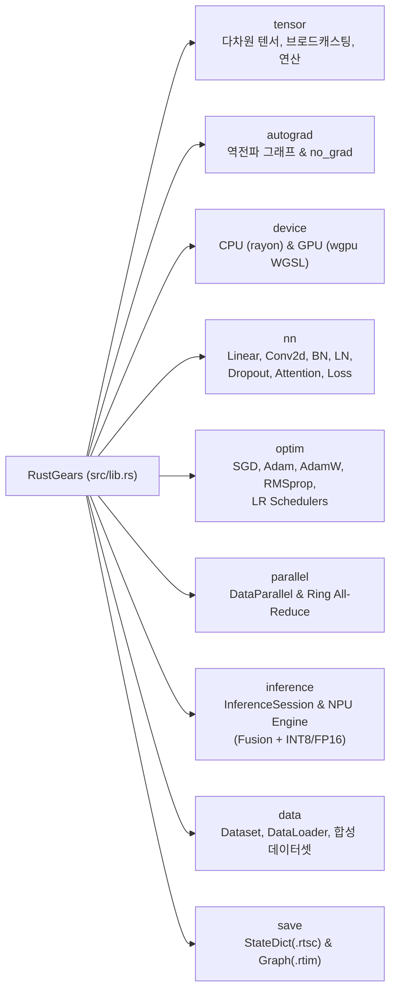
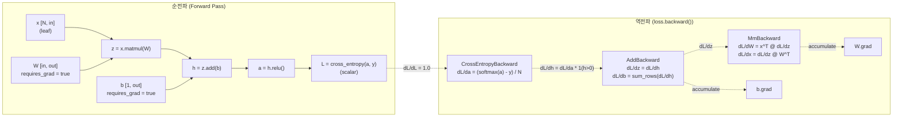
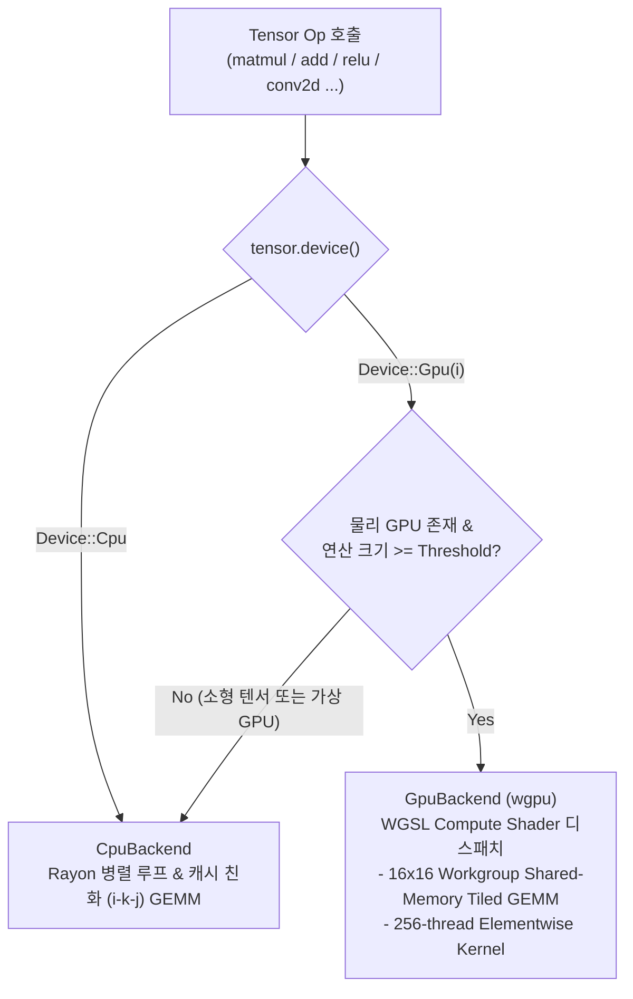
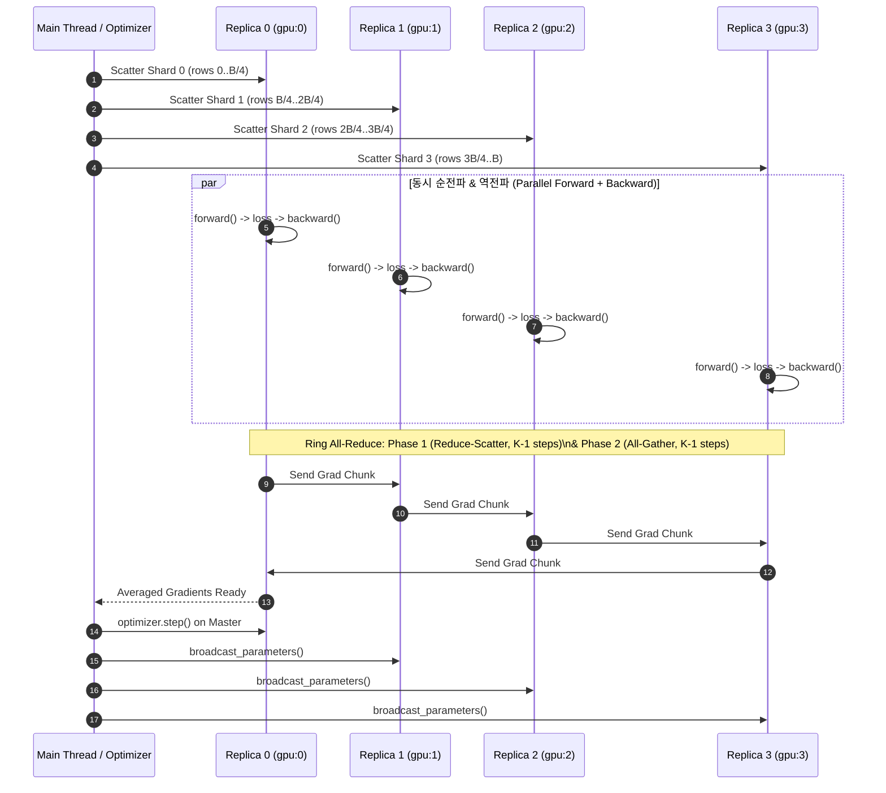
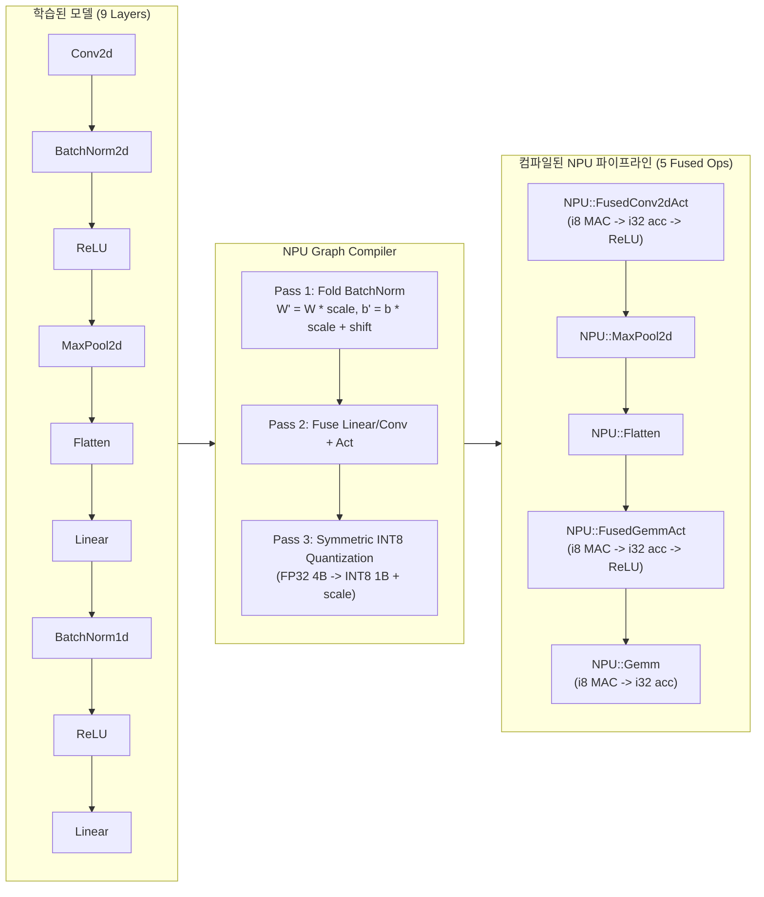

# RustGears 상세 사용 가이드 및 아키텍처 문서

이 문서는 **RustGears**의 내부 동작 원리와 API 사용법을 **Mermaid 다이어그램**과 함께 상세히 설명합니다.

---

## 목차

1. [프로젝트 모듈 구조](#1-프로젝트-모듈-구조)
2. [텐서(Tensor)와 역전파 자동 미분(Autograd)](#2-텐서tensor와-역전파-자동-미분autograd)
3. [학습 장치 선택 (CPU / GPU) 및 WGSL 커널](#3-학습-장치-선택-cpu--gpu-및-wgsl-커널)
4. [신경망 레이어 (`nn`), 손실 함수, 옵티마이저 (`optim`)](#4-신경망-레이어-nn-손실-함수-옵티마이저-optim)
5. [GPU 병렬 처리: `DataParallel` 및 `Ring All-Reduce`](#5-gpu-병렬-처리-dataparallel-및-ring-all-reduce)
6. [NPU 추론 런타임 (`ExecutionProvider::Npu`)](#6-npu-추론-런타임-executionprovidernpu)
7. [모델 저장 및 배포 (`.rtsc` / `.rtim`)](#7-모델-저장-및-배포-rtsc--rtim)

---

## 1. 프로젝트 모듈 구조



---

## 2. 텐서(`Tensor`)와 역전파 자동 미분(`Autograd`)

### 2.1 동적 계산 그래프 및 역전파 흐름

`requires_grad_(true)`가 설정된 리프(Leaf) 텐서로부터 연산이 수행되면, 각 연산은 입력 텐서들과 미분 클로저(`BackwardFn`)를 담은 `Node`를 생성합니다. `loss.backward()`를 호출하면 루트 노드에서 시작해 **위상 정렬(Topological Sort)** 역순으로 체인 룰(Chain Rule)을 적용하여 모든 리프 파라미터의 `.grad()`에 기울기를 누적합니다.



### 2.2 텐서 생성 및 연산 사용법

```rust
use RustGears::prelude::*;

// 1. 텐서 생성
let a = Tensor::from_slice(&[1.0, 2.0, 3.0, 4.0], &[2, 2]).requires_grad_(true);
let b = Tensor::ones(&[2, 2]).requires_grad_(true);
let c = Tensor::randn(&[2, 2]);

// 2. 연산자 오버로딩 및 체이닝 (브로드캐스팅 지원)
let y = (&a.matmul(&b) + &c).gelu().mean();

// 3. 역전파 실행 및 그래디언트 확인
y.backward();
println!("dy/da = {:?}", a.grad().unwrap());

// 4. 추론/평가 시 그래프 기록 비활성화
let eval_out = no_grad(|| (&a + &b).relu());
assert!(!eval_out.requires_grad());
```

---

## 3. 학습 장치 선택 (`CPU` / `GPU`) 및 WGSL 커널

### 3.1 지원 장치 및 선택 API

`Device` 열거형은 연산이 실행될 물리/가상 하드웨어를 지정합니다.

| API | 설명 |
| :--- | :--- |
| `Device::Cpu` | `rayon` Work-Stealing 스레드 풀을 사용하는 멀티코어 CPU 백엔드 |
| `Device::Gpu(index)` | `wgpu` 기반 하드웨어 GPU 백엔드(Vulkan / DirectX 12 / Metal). 해당 인덱스에 물리 GPU가 없으면 자동으로 **CPU 에뮬레이션 가상 GPU**로 폴백하여 멀티-GPU 코드를 어디서나 테스트 가능 |
| `Device::best_available()` | 물리 GPU가 감지되면 `Device::Gpu(0)`, 없으면 `Device::Cpu` 반환 |
| `Device::parse("gpu:0")` | `"cpu"`, `"gpu"`, `"cuda"`, `"gpu:1"`, `"auto"` 문자열 파싱 |
| `list_devices()` | 시스템의 CPU 및 감지된 모든 물리 GPU 목록(`DeviceInfo`) 조회 |



### 3.2 장치 지정 코드 예제

```rust
use RustGears::prelude::*;

// 시스템의 모든 학습 장치 출력
for info in list_devices() {
    println!("{info}");
}

// 문자열 또는 자동 탐색으로 장치 선택
let dev = Device::parse("auto").unwrap();

// 텐서와 모델을 선택한 장치로 이동
let x = Tensor::randn(&[128, 64]).on(dev);
let model = Sequential::new()
    .add(Linear::new(64, 128))
    .add(Gelu)
    .add(Linear::new(128, 10));
model.to(dev);

// 강제로 모든 크기의 연산을 GPU 셰이더에서 실행하려면 임계값을 0으로 설정
RustGears::device::gpu::set_offload_threshold(0, 0);

let out = model.forward(&x);
assert_eq!(out.device(), dev);
```

---

## 4. 신경망 레이어 (`nn`), 손실 함수, 옵티마이저 (`optim`)

### 4.1 레이어 및 커스텀 모듈 작성

`Sequential`로 레이어를 간편하게 쌓거나, `Module` 트레이트를 구현하여 임의의 분기/잔차(Residual) 구조를 만들 수 있습니다.

```rust
use RustGears::prelude::*;

// 1) Sequential 빌더 패턴
let cnn = Sequential::new()
    .add(Conv2d::new(1, 16, 3).stride(1).padding(1))
    .add(BatchNorm2d::new(16))
    .add(Relu)
    .add(MaxPool2d::new(2))
    .add(Flatten)
    .add(Dropout::new(0.1))
    .add(Linear::new(16 * 14 * 14, 10));

println!("{}", cnn.summary());

// 2) Transformer 블록 사용 (입력: [batch, seq_len, d_model])
let encoder = TransformerEncoderLayer::new(
    /* d_model */ 64,
    /* heads   */ 8,
    /* ff_dim  */ 256,
    /* dropout */ 0.1,
).causal(true); // GPT 스타일 Causal Mask 활성화
```

### 4.2 옵티마이저, 그래디언트 클리핑, 학습률 스케줄러 & 얼리스탑 콜백

```rust
use RustGears::prelude::*;

let model = Sequential::new().add(Linear::new(10, 32)).add(Relu).add(Linear::new(32, 2));
let mut opt = AdamW::new(model.parameters(), /* lr */ 1e-3, /* weight_decay */ 1e-2);

// 1) 지표 반응형 스케줄러 (검증 지표 정체 시 자동 감쇠)
let mut plateau_sched = ReduceLROnPlateau::new(1e-3).factor(0.5).patience(3);

// 2) 얼리스탑 (검증 지표 개선 정체 시 학습 중단 및 최고 성능 시점 가중치 복원)
let mut early_stopping = EarlyStopping::new(/* patience */ 5)
    .mode(EarlyStoppingMode::Min)
    .restore_best_weights(true);

// 3) 대형 배치 효과를 위한 그래디언트 누적 도우미
let mut accum = GradientAccumulator::new(/* accumulation_steps */ 4);

let x = Tensor::randn(&[16, 10]);
let y = Tensor::zeros(&[16]);

opt.zero_grad();
for epoch in 0..50 {
    let raw_loss = cross_entropy_smooth(&model.forward(&x), &y, /* label_smoothing */ 0.05);
    
    // 가상 배치 크기를 위해 손실 스케일링
    let loss = accum.scale_loss(&raw_loss);
    loss.backward();

    if accum.step() {
        clip_grad_norm(&model.parameters(), 1.0);
        opt.step();
        opt.zero_grad();
    }

    // 검증 후 스케줄러 및 얼리스탑 적용
    let val_loss = 0.42; // 검증 손실 예시
    plateau_sched.step(&mut opt, val_loss);

    if early_stopping.step(val_loss, &model) {
        println!("새로운 최적 모델 가중치 갱신!");
    }
    if early_stopping.should_stop() {
        println!("조기 종료 트리거됨: 최적 가중치로 자동 롤백되었습니다.");
        break;
    }
}
```

### 4.3 현대 트랜스포머 레이어 (`RMSNorm`, `SwiGLU`) 및 평가 지표

* **`RMSNorm`**: LLaMA, Gemma, Mistral 등 현대 LLM의 표준 정규화 레이어 (`x / RMS(x) * weight`).
* **`SwiGLU`**: `(SiLU(x * W_gate) * (x * W_up)) * W_down` 구조의 고효율 FFN 블록.
* **평가 지표 (`nn::metrics`)**:
  * `precision_recall_f1(&preds, &targets, num_classes)`: 클래스별 정밀도, 재현율, F1 및 Macro-F1 계산.
  * `top_k_accuracy(&logits, &targets, k)`: Top-k 정확도 산출.
  * `confusion_matrix(&preds, &targets, num_classes)`: 혼동 행렬 생성.

---

## 5. GPU 병렬 처리: `DataParallel` 및 `Ring All-Reduce`

### 5.1 데이터 병렬 학습 파이프라인

`DataParallel<M>`은 PyTorch의 `DistributedDataParallel (DDP)`과 동일한 원리로 동작합니다.

1. **Scatter**: 입력 미니배치 `[B, ...]`를 $K$개의 장치(`Gpu(0)..Gpu(K-1)`)로 균등 분할합니다.
2. **Parallel Forward & Backward**: `std::thread::scope`를 통해 각 디바이스 워커가 동시에 순전파 및 역전파를 수행합니다.
3. **Ring All-Reduce**: 모든 워커의 그래디언트 버킷을 링 토폴로지 기반 **Reduce-Scatter** ($K-1$ 스텝) + **All-Gather** ($K-1$ 스텝)로 평균화합니다.
4. **Update & Broadcast**: 마스터 레플리카에서 옵티마이저 스텝을 적용한 뒤 갱신된 파라미터와 버퍼를 모든 레플리카에 동기화합니다.



### 5.2 `DataParallel` 사용 코드

```rust
use RustGears::prelude::*;

let devices = vec![Device::Gpu(0), Device::Gpu(1), Device::Gpu(2), Device::Gpu(3)];

// 각 디바이스에 동일한 초기 가중치로 모델 레플리카 생성
let dp = DataParallel::new(devices, || {
    Sequential::new()
        .add(Linear::new(8, 64))
        .add(BatchNorm1d::new(64))
        .add(Relu)
        .add(Linear::new(64, 4))
});

let mut opt = AdamW::new(dp.parameters(), 1e-2, 1e-4);
let x = Tensor::randn(&[64, 8]);
let y = Tensor::zeros(&[64]);

// 1-스텝 데이터 병렬 학습 (Scatter + 병렬 Backward + Ring All-Reduce + Opt Step + Broadcast)
let report = dp.fit_batch(&x, &y, cross_entropy, &mut opt);

println!(
    "Batch loss = {:.4}, Ring All-Reduce = {} steps ({} bytes transferred)",
    report.loss, report.allreduce.steps, report.allreduce.bytes_sent
);
for r in &report.replicas {
    println!("  [{}] {} samples, loss={:.4}, time={:?}", r.device, r.samples, r.loss, r.compute_time);
}
```

---

## 6. NPU 추론 런타임 (`ExecutionProvider::Npu`)

### 6.1 NPU 컴파일러 및 Systolic Array 실행 파이프라인

학습이 끝난 모델은 `InferenceSession::from_module(&model, ExecutionProvider::npu_int8())`를 통해 NPU 전용 명령어 시퀀스로 컴파일됩니다.

1. **Pass 1 — BatchNorm 폴딩(Folding)**: 추론 시 고정된 `BatchNorm1d/2d`의 스케일($\gamma / \sqrt{\sigma^2 + \epsilon}$)과 시프트($\beta - \mu \cdot \text{scale}$)를 앞선 `Linear` 또는 `Conv2d`의 가중치/바이어스에 수학적으로 흡수하여 레이어를 제거합니다.
2. **Pass 2 — 연산자 퓨전(Operator Fusion)**: `Linear/Conv2d + Activation(ReLU, GELU, ...)`을 단일 NPU 매크로 명령어(`NPU::FusedGemmAct`, `NPU::FusedConv2dAct`)로 결합하여 온칩 SRAM 밖으로 중간 텐서가 나가지 않도록 합니다.
3. **Pass 3 — 대칭 INT8 / FP16 양자화(Quantization)**:
   - **INT8 모드**: 가중치와 입력 활성값을 대칭 스케일($s = \max |x| / 127$)로 `i8` (`[-127, 127]`)에 양자화하고, Systolic Array MAC에서 `i8 × i8 → i32` 누산 후 $s_x \cdot s_w$ 스케일 복원 + 바이어스 + 활성화 함수를 한 번에 적용합니다. 가중치 메모리가 **약 3.7~4.0배 압축**됩니다.
   - **FP16 모드**: IEEE-754 binary16 가수 정밀도로 라운딩된 텐서 코어 경로로 실행하며 가중치를 **2.0배 압축**합니다.



### 6.2 NPU 추론 및 텔레메트리(`NpuProfile`) 확인

```rust
use RustGears::prelude::*;

let model = Sequential::new()
    .add(Linear::new(16, 64))
    .add(BatchNorm1d::new(64))
    .add(Relu)
    .add(Linear::new(64, 4));

// 1. NPU INT8 세션 컴파일 (FP16을 원하면 ExecutionProvider::npu_fp16())
let session = InferenceSession::from_module(&model, ExecutionProvider::npu_int8()).unwrap();

// 컴파일 리포트 (레이어 퓨전 내역 및 메모리 압축률)
println!("{}", session.compilation_report());

// 2. NPU에서 추론 실행
let input = Tensor::randn(&[32, 16]);
let logits = session.run(&input);

// 3. 하드웨어 프로파일 확인 (총 MAC 연산 수, 레이어별 지연 시간, 유효 GOPS)
if let Some(profile) = session.last_npu_profile() {
    println!("{profile}");
}
```

출력 예시:
```text
InferenceSession [provider = NPU (INT8), layers: 4 -> 2 fused ops, weights: 5392 B -> 1552 B (3.47x compression)]
  Pipeline: NPU::FusedGemmAct(16->64, ReLU) -> NPU::Gemm(64->4)
NPU Profile [INT8 | layers: 4 -> 2 fused | weights: 5392 B -> 1552 B (3.47x) | MACs: 40960 | time: 84.2µs (0.97 GOPS)]
  - NPU::FusedGemmAct(16->64, ReLU)                  32768 MACs   61.5µs
  - NPU::Gemm(64->4)                                  8192 MACs   21.9µs
```

---

## 7. 모델 저장 및 배포 (`.rtsc` / `.rtim`)

RustGears는 두 가지 바이너리 포맷을 제공합니다.

1. **`RTSC` (`save_state_dict` / `load_state_dict`)**: PyTorch의 `state_dict`처럼 파라미터 및 BatchNorm 러닝 통계(`named_buffers`)를 이름별로 저장하고 복원합니다(재학습/체크포인트용).
2. **`RTIM` (`save_inference_model` / `load_inference_layers`)**: 모델 구조와 가중치를 함께 직렬화하여, 원본 Rust 모델 타입 정의 없이도 `InferenceSession`에서 즉시 로드해 **NPU / GPU / CPU**에서 실행할 수 있는 배포용 포맷입니다.

```rust
use RustGears::prelude::*;

let model = Sequential::new()
    .add(Linear::new(4, 16))
    .add(BatchNorm1d::new(16))
    .add(Relu)
    .add(Linear::new(16, 2));

// 1) 학습 체크포인트 저장 & 복원 (.rtsc)
save_state_dict(&model, "checkpoint.rtsc").unwrap();
load_state_dict(&model, "checkpoint.rtsc").unwrap();

// 2) 배포용 추론 모델 익스포트 (.rtim) -> NPU에서 바로 로드하여 실행
save_inference_model(&model, "deploy_model.rtim").unwrap();
let layers = load_inference_layers("deploy_model.rtim").unwrap();
let npu = InferenceSession::from_layers(layers, ExecutionProvider::npu_int8());
let output = npu.run(&Tensor::randn(&[8, 4]));
```
